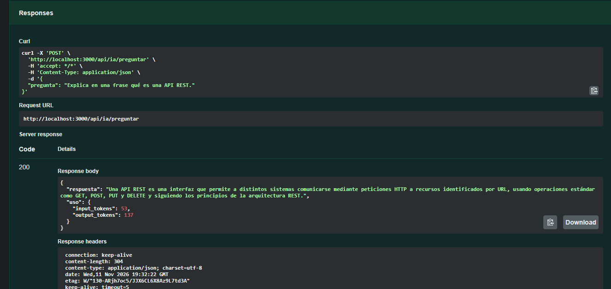
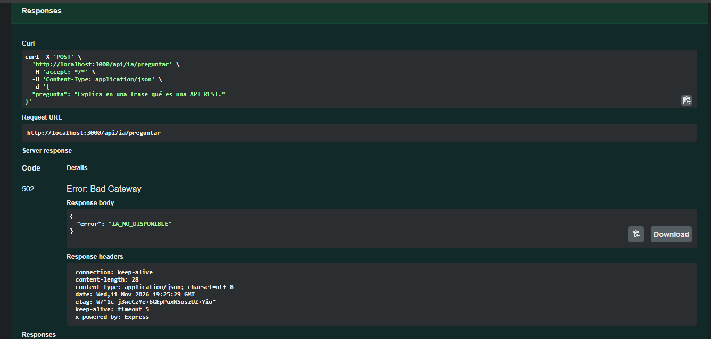

# Laboratorio 5: API REST con Express, Swagger y DeepSeek

API REST para crear, consultar, listar y eliminar notas. También permite enviar preguntas a DeepSeek y resumir el contenido de una nota.

## Autoría

- Estudiante: completar con tu nombre.
- Modalidad: trabajo individual.
- Integración IA: DeepSeek API.

## Requisitos

- Node.js 20 o superior.
- Una API key de DeepSeek.

## Instalación y ejecución

```bash
npm install
npm run dev
```

La documentación interactiva queda disponible en `http://localhost:3000/api-docs`.

## Variables de entorno

Configura estas variables en un archivo local `.env`. No compartas ni subas ese archivo.

- `DEEPSEEK_API_KEY`
- `DEEPSEEK_MODEL`
- `PORT`

Usa `.env.example` como referencia. `.gitignore` excluye `.env` y `node_modules/`.

## Endpoints

| Método | Ruta | Función |
|---|---|---|
| GET | `/api/notas` | Lista notas |
| GET | `/api/notas/:id` | Obtiene una nota |
| POST | `/api/notas` | Crea una nota |
| DELETE | `/api/notas/:id` | Elimina una nota |
| POST | `/api/ia/preguntar` | Envía una pregunta a DeepSeek |
| POST | `/api/notas/:id/resumen` | Resume una nota en tres viñetas |
| GET | `/api-docs` | Abre Swagger UI |

Las notas se almacenan en memoria y se reinician al reiniciar el servidor.

## Verificación realizada

Pruebas manuales locales realizadas: crear nota (`201`), listar (`200`), body inválido (`400`), nota inexistente (`404`), eliminar (`204`) y Swagger UI (`200`). Pregunta y resumen devolvieron respuestas reales de DeepSeek. La pregunta usó 54 tokens de entrada y 84 de salida; el resumen usó 73 tokens de entrada y 121 de salida.

## Capturas

Pregunta exitosa de `POST /api/ia/preguntar` (200):



Clave inválida, con respuesta genérica `IA_NO_DISPONIBLE` (502):



## Reflexión

1. **¿Por qué la API key no puede estar en el frontend?** Si se incluye en el código o bundle del navegador, cualquier usuario puede inspeccionarlo, copiarla y usarla, posiblemente consumiendo la cuota del propietario. La clave se guarda en el backend dentro de `.env`.
2. **¿Qué responde la API cuando DeepSeek rechaza la clave?** El manejador transforma los errores del proveedor en `IA_NO_DISPONIBLE` y no expone el mensaje original al cliente.
3. **¿Qué diferencia hay entre `system` y `messages`?** `system` define instrucciones generales; el mensaje del usuario contiene la petición concreta. Para un resumen, el `system` pide tres viñetas breves y el contenido de la nota es el mensaje del usuario.
4. **¿Cuántos tokens usaron dos llamadas y cómo limitar el costo?** La pregunta usó 54 tokens de entrada y 84 de salida; el resumen usó 73 de entrada y 121 de salida. `max_tokens` limita la salida; la validación Zod también limita la longitud de entrada.
5. **¿Qué ocurriría sin validar el body?** Entradas vacías o enormes podrían generar respuestas inútiles y aumentar el consumo; también podrían causar errores evitables.
6. **¿Qué conflicto de Git tuvieron al integrar ramas?** No hubo integración de ramas ni conflicto porque el trabajo se realiza individualmente. No se atribuyen commits ni revisiones a otra persona.

## Entrega individual

La guía original evalúa colaboración en pareja. Este repositorio se está desarrollando individualmente; no se inventan integrantes, revisiones, commits o pull requests de otra persona.
